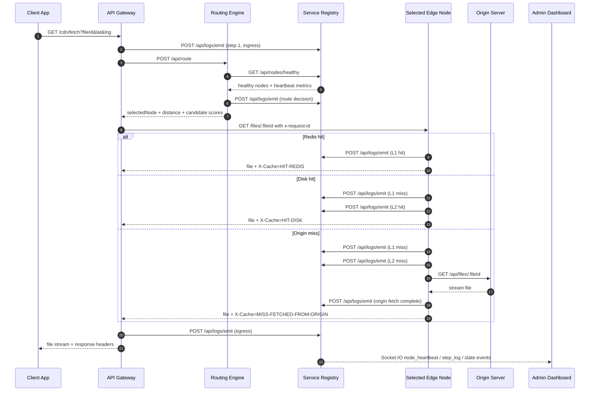
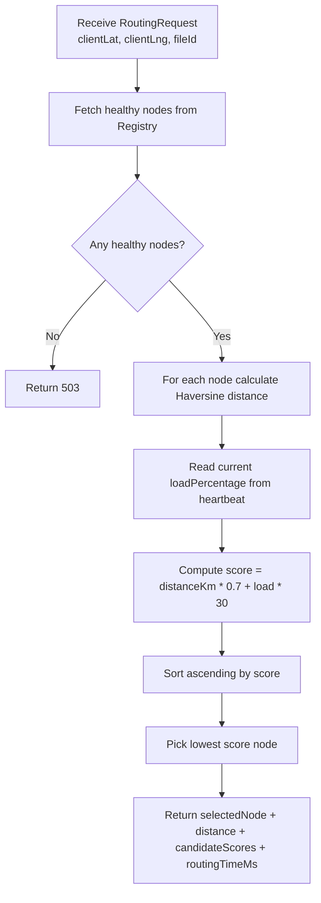
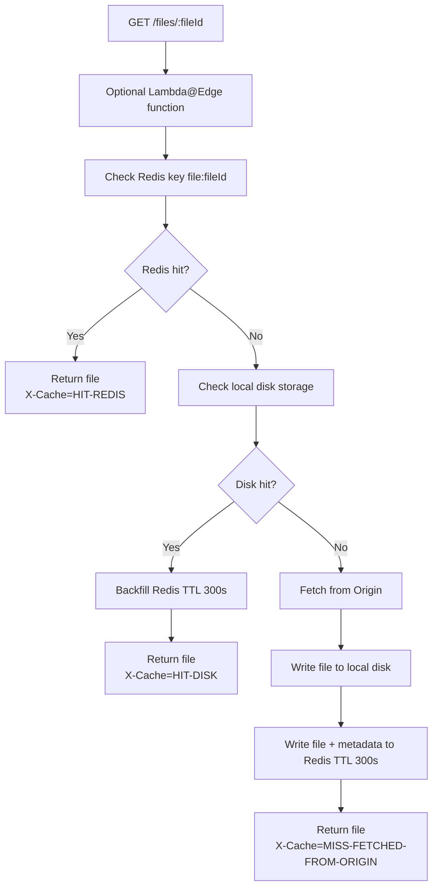
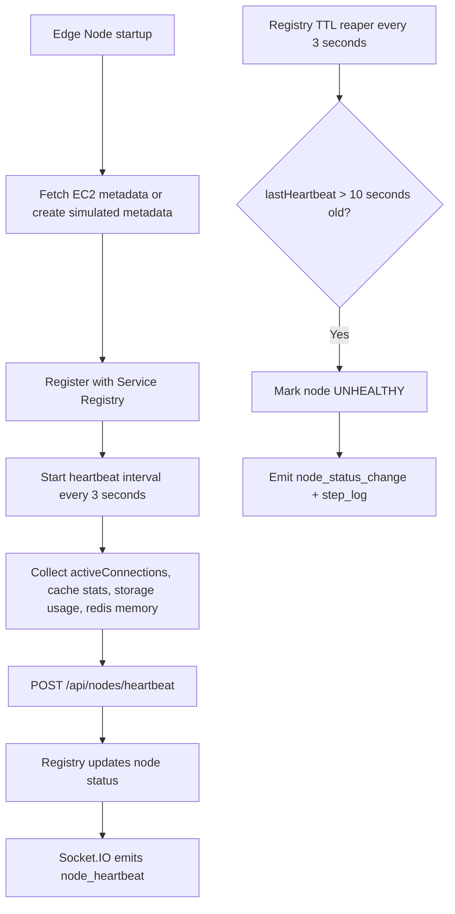
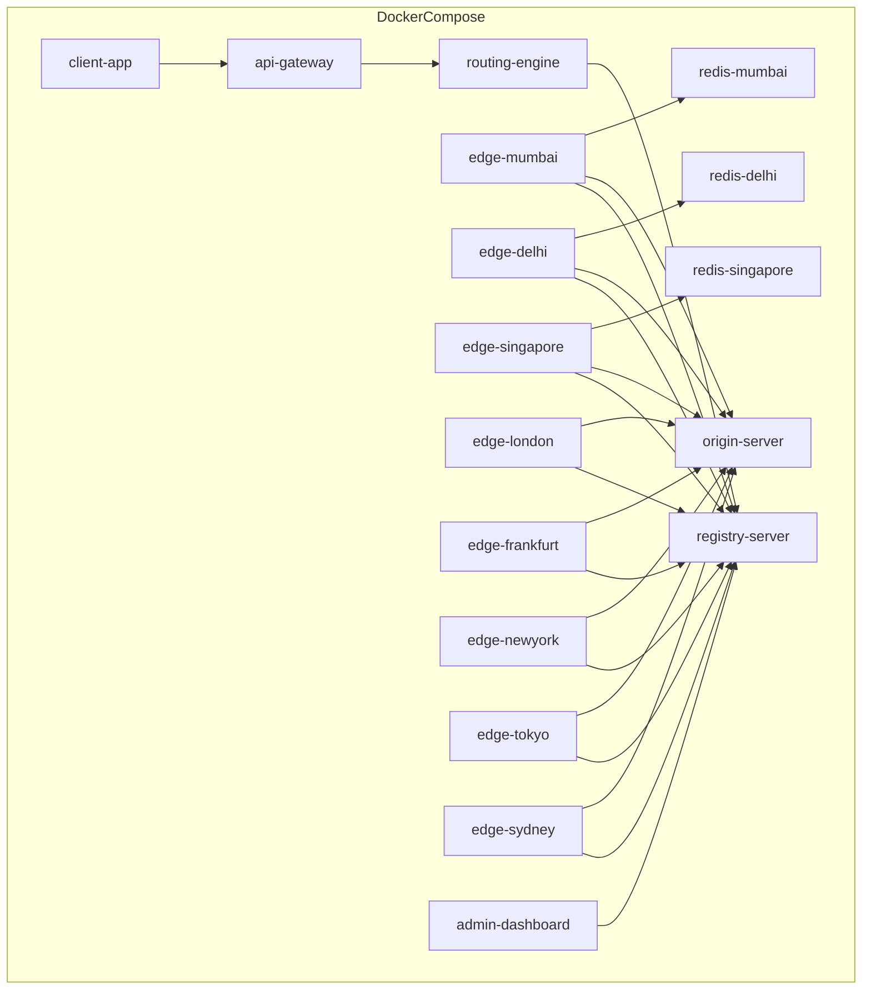

# EdgeMesh Architecture Diagrams and Interview Notes

This document is based on the actual implementation in this repository, not only the project idea docs. It combines:

- High-Level Design (HLD)
- Low-Level Design (LLD)
- Mermaid diagrams
- Interview explanation points
- Key design decisions and tradeoffs

## 1. Project Summary

EdgeMesh is a CDN simulator built as a TypeScript monorepo. It demonstrates:

- API Gateway based ingress
- Geo-aware edge selection
- Load-aware routing
- Service discovery through a registry
- Heartbeat-driven health monitoring
- Multi-level edge caching
- Origin as source of truth
- Real-time observability with Socket.IO
- Standalone as well as Dockerized deployment

What makes this project stronger than a basic CDN demo is that the implementation also includes:

- proactive edge pre-warming on upload
- Redis fallback using `MockRedis`
- AWS S3 and CloudFront simulation hooks in Origin
- Lambda@Edge-style response mutation simulation at the edge
- a live admin dashboard plus a client request simulator

---

## 2. High-Level Design

### HLD Mermaid Diagram

```mermaid
flowchart TD
    Client[Client Simulator / Browser User<br/>apps/client :5174]
    Admin[Admin Dashboard<br/>apps/dashboard :5173]

    Gateway[API Gateway<br/>apps/gateway :3000]
    Routing[Routing Engine<br/>apps/routing-engine :3001]
    Registry[Service Registry<br/>apps/registry :3002<br/>+ Socket.IO]
    Origin[Origin Server<br/>apps/origin :5000]

    subgraph EdgeLayer[Distributed Edge Layer]
        E1[Edge Mumbai :4001]
        E2[Edge Delhi :4002]
        E3[Edge Singapore :4003]
        E4[Edge London :4004]
        E5[Edge Frankfurt :4005]
        E6[Edge New York :4006]
        E7[Edge Tokyo :4007]
        E8[Edge Sydney :4008]
    end

    subgraph SharedPackages[Shared Packages]
        T1[shared-types]
        T2[shared-utils]
        T3[logger]
    end

    Client -->|GET /cdn/fetch| Gateway
    Client -->|select file list| Origin
    Admin -->|Socket.IO subscribe| Registry
    Admin -->|inspect caches/files| E1
    Admin -->|inspect caches/files| E2
    Admin -->|inspect caches/files| E3
    Admin -->|origin file upload/list| Origin

    Gateway -->|POST /api/route| Routing
    Routing -->|GET /api/nodes/healthy| Registry
    Gateway -->|proxy file request| E1
    Gateway -->|proxy file request| E2
    Gateway -->|proxy file request| E3
    Gateway -->|proxy file request| E4
    Gateway -->|proxy file request| E5
    Gateway -->|proxy file request| E6
    Gateway -->|proxy file request| E7
    Gateway -->|proxy file request| E8

    E1 -->|cache miss fetch| Origin
    E2 -->|cache miss fetch| Origin
    E3 -->|cache miss fetch| Origin
    E4 -->|cache miss fetch| Origin
    E5 -->|cache miss fetch| Origin
    E6 -->|cache miss fetch| Origin
    E7 -->|cache miss fetch| Origin
    E8 -->|cache miss fetch| Origin

    E1 -->|register + heartbeat + step logs| Registry
    E2 -->|register + heartbeat + step logs| Registry
    E3 -->|register + heartbeat + step logs| Registry
    E4 -->|register + heartbeat + step logs| Registry
    E5 -->|register + heartbeat + step logs| Registry
    E6 -->|register + heartbeat + step logs| Registry
    E7 -->|register + heartbeat + step logs| Registry
    E8 -->|register + heartbeat + step logs| Registry

    Origin -->|broadcast uploaded file| E1
    Origin -->|broadcast uploaded file| E2
    Origin -->|broadcast uploaded file| E3
    Origin -->|broadcast uploaded file| E4
    Origin -->|broadcast uploaded file| E5
    Origin -->|broadcast uploaded file| E6
    Origin -->|broadcast uploaded file| E7
    Origin -->|broadcast uploaded file| E8

    Gateway -. uses .-> T1
    Gateway -. uses .-> T2
    Gateway -. uses .-> T3
    Routing -. uses .-> T1
    Routing -. uses .-> T2
    Routing -. uses .-> T3
    Registry -. uses .-> T1
    Registry -. uses .-> T3
    Origin -. uses .-> T1
    Origin -. uses .-> T3
    E1 -. uses .-> T1
    E1 -. uses .-> T3
```



### HLD Explanation Points

- The browser never talks directly to internal routing logic. The API Gateway is the single ingress point.
- The Routing Engine is separated so route calculation remains an isolated decision service.
- The Service Registry is the dynamic control plane for node health and discovery.
- Edge Nodes are stateless in logic but stateful in cache content.
- Origin remains the source of truth for file content and metadata.
- The Admin Dashboard is read/observe heavy and uses Socket.IO for real-time visibility.
- Shared packages reduce duplication and keep contracts consistent across services.

### Why this HLD was chosen

- It mirrors real distributed systems concepts without requiring real Anycast, BGP, or cloud infra.
- It keeps responsibilities clean enough to discuss system design principles in interviews.
- It allows each major concern to be demonstrated independently: ingress, routing, discovery, caching, and observability.

### HLD Tradeoffs

- Microservices improve separation of concerns, but they increase network hops and operational complexity.
- A single API Gateway simplifies clients, but it becomes a scaling and availability focal point in production.
- The in-memory registry is fast and simple, but it is not durable and is a single point of failure.
- Pull-based edge caching is storage-efficient, but cold requests pay miss latency.

---

## 3. End-to-End Request Flow



### Flow talking points for interview

- Request tracing starts at the Gateway with a generated `X-Request-ID`.
- The Routing Engine does not store persistent state; it calculates against live registry data.
- The selected edge executes a waterfall cache lookup: Redis, Disk, then Origin.
- Every important step emits a log event so the dashboard can replay the request path.
- The client receives useful response headers such as selected node, distance, cache result, and end-to-end latency.

---

## 4. Low-Level Design

### LLD Component Diagram

```mermaid
flowchart LR
    subgraph GatewayService[API Gateway]
        G1[Express App]
        G2[GET /cdn/fetch]
        G3[POST /cdn/upload]
        G4[generateRequestId]
        G5[emitStepLog]
    end

    subgraph RoutingService[Routing Engine]
        R1[Express App]
        R2[POST /api/route]
        R3[GET healthy nodes]
        R4[Haversine calculation]
        R5[Composite scoring]
    end

    subgraph RegistryService[Service Registry]
        S1[registeredNodes Map]
        S2[nodeHeartbeats Map]
        S3[POST /api/nodes/register]
        S4[POST /api/nodes/heartbeat]
        S5[GET /api/nodes/healthy]
        S6[POST /api/logs/emit]
        S7[TTL reaper]
        S8[Socket.IO broadcaster]
    end

    subgraph EdgeService[Edge Node]
        E1[Express App]
        E2[MockRedis or ioredis]
        E3[L2 local storage dir]
        E4[GET /files/:fileId]
        E5[POST /api/files/broadcast]
        E6[heartbeat sender]
        E7[Lambda@Edge simulation]
    end

    subgraph OriginService[Origin]
        O1[Express App]
        O2[multer upload]
        O3[metadata.json]
        O4[local storage]
        O5[AWS S3 integration mode]
        O6[CloudFront invalidation simulation]
        O7[broadcast to healthy edges]
    end

    G2 --> G4
    G2 --> G5
    G2 --> R2
    G3 --> O2

    R2 --> R3
    R2 --> R4
    R2 --> R5

    R3 --> S5
    G5 --> S6
    E6 --> S4
    E5 --> S6
    O7 --> S5
    S7 --> S2
    S6 --> S8

    G2 --> E4
    E4 --> E7
    E4 --> E2
    E4 --> E3
    E4 --> O1
    O2 --> O3
    O2 --> O4
    O2 --> O5
    O2 --> O6
    O2 --> O7
```

### LLD: Routing Decision Logic



### LLD: Edge Cache Waterfall



### LLD: Node Lifecycle and Health



---

## 5. Component-by-Component Explanation

### API Gateway

- Main purpose: hide internal topology and provide one client-facing entry point.
- Important endpoints:
  - `GET /cdn/fetch`
  - `POST /cdn/upload`
  - `GET /health`
- Important behavior:
  - generates request ID
  - calls routing engine
  - proxies final edge response
  - passes CDN metrics via headers
  - emits step logs to registry

Why this decision was made:

- It avoids CORS complexity and prevents the browser from needing to know edge node locations.

Tradeoff:

- Adds one more hop before content reaches the client.

### Routing Engine

- Main purpose: determine the best edge node for a request.
- Inputs:
  - client latitude
  - client longitude
  - live healthy node list
  - current load percentages
- Formula used:
  - `score = distanceKm * 0.7 + loadPercentage * 30`

Why this decision was made:

- Distance alone is not enough; nearest-node-only routing can overload hot regions.

Tradeoff:

- This is a simplified heuristic, not real network latency measurement.
- CPU load is only one signal; production systems would use richer telemetry.

### Service Registry

- Main purpose: service discovery and control-plane health tracking.
- Data structures:
  - `registeredNodes: Map<string, EdgeNodeConfig>`
  - `nodeHeartbeats: Map<string, NodeHeartbeat>`
- Features:
  - registration
  - heartbeats
  - healthy node listing
  - TTL-based unhealthy marking
  - Socket.IO broadcasting

Why this decision was made:

- A central registry makes routing easy and keeps node management explicit for interview discussion.

Tradeoff:

- In-memory state is simple and fast, but it is not persistent or distributed.

### Edge Node

- Main purpose: serve content as close to the client as possible.
- Internal layers:
  - L1 Redis cache
  - L2 local disk cache
  - L3 origin fetch
- Extra features:
  - proactive pre-warm endpoint on upload
  - MockRedis fallback
  - simulated Lambda@Edge functions
  - per-node local storage
  - heartbeat publishing

Why this decision was made:

- This component is where CDN value is demonstrated most clearly: locality, caching, fallback, and response mutation.

Tradeoff:

- Per-node local disk improves realism, but it creates duplicated content across regions.
- Base64 storing full file content in Redis is simple for a demo, but not memory efficient for large files.

### Origin Server

- Main purpose: hold the master copy and metadata for all files.
- Storage:
  - local `storage/`
  - `metadata.json`
- APIs:
  - upload
  - list
  - serve
  - delete
- Extra features:
  - AWS S3 simulation or real mode based on credentials
  - CloudFront invalidation simulation
  - broadcast uploaded file to healthy edges

Why this decision was made:

- It models the authoritative storage tier while still being runnable locally.

Tradeoff:

- JSON metadata storage is easy to inspect, but it does not scale like a real database.

### Dashboard

- Main purpose: make invisible distributed-system behavior observable.
- Shows:
  - node health
  - cache counters
  - Redis key TTLs
  - origin files
  - step logs
  - selected node storage details
  - simulated EC2 metadata

Why this decision was made:

- Interviewers understand systems better when you can visually prove routing, failover, and caching behavior.

Tradeoff:

- Dashboard reads several services directly, which is convenient for a demo but looser than a strict production boundary.

### Client Simulator

- Main purpose: generate deterministic scenarios for demos and interviews.
- Lets you:
  - choose coordinates
  - choose a file
  - run a CDN fetch
  - inspect response headers
  - simulate Lambda@Edge functions

Why this decision was made:

- It makes route selection and cache behavior reproducible from many regions.

Tradeoff:

- It uses user-supplied coordinates instead of real IP-based geolocation.

---

## 6. Storage and Data Model Notes

### Shared Types Used Across Services

- `EdgeNodeConfig`
- `NodeHeartbeat`
- `RoutingRequest`
- `RoutingResponse`
- `FileMetadata`
- `StepLogEvent`

Why this is important:

- Shared contracts reduce integration bugs across services in a monorepo.

Tradeoff:

- Tight shared contracts improve consistency but create stronger compile-time coupling between services.

### Cache Keys

- file content: `file:{fileId}`
- file metadata: `file:meta:{fileId}`

Why this decision was made:

- Separating content and metadata keeps the retrieval logic straightforward and makes demo inspection easier.

Tradeoff:

- Two related keys can drift if writes fail halfway; production systems may prefer atomic structures or pipelines.

---

## 7. Deployment View



### Deployment explanation points

- The project supports a full microservice mode under Docker Compose.
- It also supports a standalone mode using `servers/core` plus standalone edge nodes.
- This dual-mode setup improves demo reliability because the project can still run if Docker or Redis is unavailable.

Tradeoff:

- Supporting both deployment styles improves usability, but it increases maintenance overhead.

---

## 8. Important Design Decisions You Should Say in Interview

### 1. Why microservices instead of a single app?

- To isolate concerns: ingress, routing, discovery, origin, and caching all change for different reasons.
- It makes scaling and failure scenarios easier to explain.

Tradeoff:

- More moving parts, more network calls, more operational complexity.

### 2. Why a central service registry?

- Routing needs a consistent view of healthy edge nodes.
- Heartbeat-driven discovery makes failover visible and testable.

Tradeoff:

- Centralization creates a control-plane bottleneck and SPOF unless replicated.

### 3. Why 3-tier caching?

- It demonstrates latency tiers clearly:
  - L1 fastest
  - L2 persistent local fallback
  - L3 authoritative but slowest

Tradeoff:

- More layers mean more invalidation and consistency complexity.

### 4. Why proactive broadcast after upload?

- It reduces first-request penalty for newly uploaded files.
- It helps you discuss pre-warming and hybrid pull/push caching.

Tradeoff:

- Extra network and storage cost across many edge nodes.

### 5. Why MockRedis fallback?

- The project remains runnable for demos even when Redis or Docker is down.

Tradeoff:

- Behavior remains functionally similar, but it is no longer a true external cache dependency.

### 6. Why simulated AWS integration?

- It shows cloud-awareness without making the project unusable for local interview demos.

Tradeoff:

- It demonstrates concepts, but it is not a full production-grade cloud deployment.

### 7. Why Lambda@Edge simulation inside edge nodes?

- It shows that CDNs can do more than cache; they can also mutate responses near the edge.

Tradeoff:

- Local simulation is useful conceptually, but it is not equivalent to actual globally replicated serverless edge execution.

---

## 9. Weak Points You Should Acknowledge Honestly

These are good to mention because they show engineering maturity:

- The registry is in-memory and not fault tolerant.
- There is no distributed consensus or persistent service discovery backend.
- Cache invalidation is basic; there is no targeted purge API across all edges.
- Redis stores full base64 file data, which is not ideal for very large files.
- Route selection uses heuristic scoring instead of real network latency.
- Request collapsing is not implemented, so concurrent cold misses could stampede origin.
- Security is minimal for the demo; there are no signed URLs or rate limits in the main flow.

---

## 10. Strong Interview Close

You can summarize the project like this:

> EdgeMesh is a CDN simulator that models how distributed content delivery works end to end: client ingress through a gateway, dynamic route selection using geography and load, heartbeat-based service discovery, edge caching with Redis plus disk fallback, authoritative origin storage, and real-time observability. I intentionally kept it locally runnable while still adding production-inspired ideas like pre-warming, cloud integration hooks, and edge-side response functions, so it is both demonstrable and architecturally rich.

